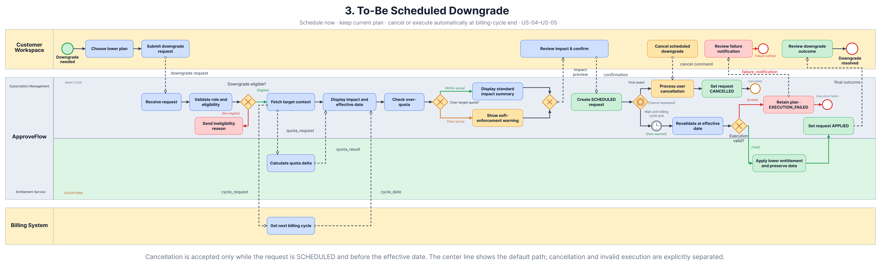
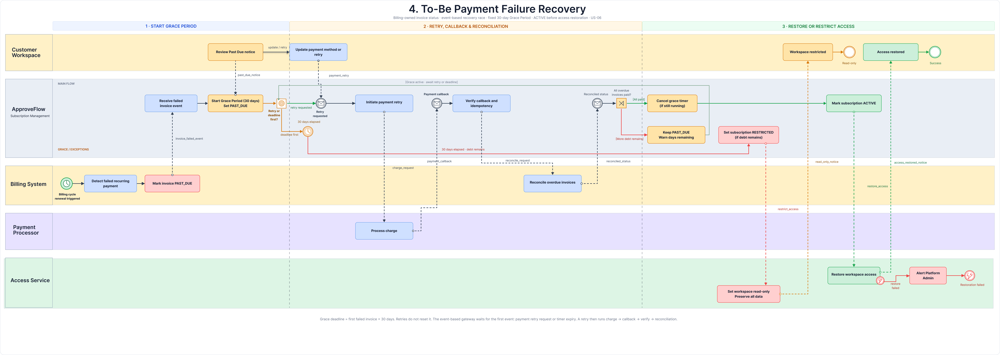

> Source: [Process Models](https://mindyworkflows.atlassian.net/wiki/spaces/~712020023d2d45822847ceae0a13314552bb4b/pages/131226) · Content ID `131226` · Version `13` · Status `current`

## Packaged workflows

### Scheduled Downgrade

### Payment Failure Recovery

# Purpose

This page compares the current manual process with the three target capabilities: Self-Service Upgrade, Scheduled Downgrade and Payment Failure Recovery.

As-Is · To-Be Upgrade · To-Be Scheduled Downgrade · To-Be Payment Failure Recovery

---

## 1. As-Is Subscription Management Process

Upgrade and downgrade requests are handled manually across Customer Support, Finance / Operations, the Payment Processor and the Subscription System.

As-Is Subscription Management

**Source file:** <https://www.figma.com/design/ZBPovUXDJwxaT3sJhn2Zu9/ApproveFlow-%E2%80%94-SaaS-Subscription-Management?node-id=212-887&t=NLj8rfer20hl6yoP-1>  

### Flow Summary

1. The customer submits a plan-change request through Customer Support.
2. Support validates the workspace, requester and requested plan.
3. Finance / Operations manually reviews pricing, proration and billing impact.
4. Payment is coordinated with the customer and the processor returns the result.
5. After successful payment, plan and entitlement data are updated manually; failed payment requires manual follow-up.

### Key Pain Points

| **ID** | **Problem** | **Impact** |
| --- | --- | --- |
| PP-01 | Support queue delays plan changes. | Slow customer activation. |
| PP-02 | Multiple Support and Finance hand-offs. | Higher effort and communication risk. |
| PP-03 | Pricing and proration are reviewed manually. | Inconsistent charges and disputes. |
| PP-04 | Failed payments require manual follow-up. | Requests may remain unresolved. |
| PP-05 | Plan, quota and entitlement updates are manual. | Incorrect access or quota risk. |

---

## 2. To-Be Upgrade Subscription Process

An authorized Workspace Owner or Billing Admin can preview pricing, confirm payment and activate a higher plan without Support intervention.

To-Be Self-Service Upgrade

**Source file**: <https://www.figma.com/design/ZBPovUXDJwxaT3sJhn2Zu9/ApproveFlow-%E2%80%94-SaaS-Subscription-Management?node-id=245-569&t=NLj8rfer20hl6yoP-1> 

### Flow Summary

1. The user selects a higher-ranked plan.
2. ApproveFlow validates permission, subscription status and request eligibility.
3. The Billing System returns the proration, tax/VAT, discount and payable total for display.
4. The user confirms payment and ApproveFlow verifies the processor callback.
5. Successful payment triggers plan and entitlement activation.

### Key Outcomes

- **Payment failed:** retain the current plan and allow retry.
- **Payment succeeded:** activate the target-plan entitlement.
- **Activation failed:** do not charge again; retry automatically or escalate.

---

## 3. To-Be Scheduled Downgrade Process

An authorized user can review downgrade impact, schedule a lower plan for the billing-cycle end and cancel it before the effective date.

To-Be Scheduled Downgrade

Source file: <https://www.figma.com/design/ZBPovUXDJwxaT3sJhn2Zu9/ApproveFlow-%E2%80%94-SaaS-Subscription-Management?node-id=245-689&t=NLj8rfer20hl6yoP-1> 

### Flow Summary

1. The user selects a lower-ranked plan and reviews quota, feature and effective-date impact.
2. ApproveFlow validates eligibility and creates a Scheduled Subscription Change Request (**SCR**).
3. The current plan remains active until the effective date.
4. The user may cancel before the effective date.
5. At period end, ApproveFlow revalidates the request before applying the lower entitlement.

### Key Outcomes

- **Over quota:** scheduling remains allowed; new usage above the lower quota is restricted after the effective date.
- **Cancelled:** retain the current plan and close the request.
- **Execution failed:** do not partially apply the lower entitlement; retain the current plan.

---

## 4. To-Be Payment Failure Recovery Process

Recover failed recurring payments within the Grace Period and apply restriction or restoration only from verified billing outcomes.

To-Be Payment Failure Recovery

Source file: <https://www.figma.com/design/ZBPovUXDJwxaT3sJhn2Zu9/ApproveFlow-%E2%80%94-SaaS-Subscription-Management?node-id=210-774&t=NLj8rfer20hl6yoP-1> 

#### Flow Summary

1. Billing System reports a failed recurring payment; ApproveFlow records the invoice as `Past Due`, starts the one-calendar-month Grace Period and notifies the Billing Admin.
2. The user may open the Payment Processor-hosted update flow and retry. ApproveFlow receives references and verified results only.
3. Verified recovery before expiry retains access. If the Grace Period expires with a required invoice still unpaid, ApproveFlow restricts the workspace.
4. After all required invoices are paid, ApproveFlow requests restoration. A failed restoration is retried and escalated without another charge.

### Key Outcomes

- Billing System owns invoice and payment status.
- Payment Processor owns payment credentials and execution.
- ApproveFlow orchestrates notification, recovery, restriction and restoration.
- No duplicate payment or unverified access transition is allowed.

## 5. Related Artefacts

| **Purpose** | **Link** |
| --- | --- |
| Business context | [Business Brief](https://mindyworkflows.atlassian.net/wiki/spaces/~712020023d2d45822847ceae0a13314552bb4b/pages/229409/Business+Brief) · [Scope, Stakeholders & Success Metrics](https://mindyworkflows.atlassian.net/wiki/spaces/~712020023d2d45822847ceae0a13314552bb4b/pages/229417/Scope+Stakeholders+Success+Metrics) |
| Rules and decisions | [Business Rules & Decision Tables](https://mindyworkflows.atlassian.net/wiki/spaces/~712020023d2d45822847ceae0a13314552bb4b/pages/98325/Business+Rules+Decision+Tables) · [Downgrade Eligibility Decision Table](https://mindyworkflows.atlassian.net/wiki/spaces/~712020023d2d45822847ceae0a13314552bb4b/pages/98325/Business+Rules+Decision+Tables) · [Upgrade Payment Outcome Decision Table](https://mindyworkflows.atlassian.net/wiki/spaces/~712020023d2d45822847ceae0a13314552bb4b/pages/98325/Business+Rules+Decision+Tables) |
| State behaviour | [State Transition Model](https://mindyworkflows.atlassian.net/wiki/spaces/~712020023d2d45822847ceae0a13314552bb4b/pages/131234/State+Transition+Model+Specification) |
| Exceptions | [Exception Matrix](https://mindyworkflows.atlassian.net/wiki/spaces/~712020023d2d45822847ceae0a13314552bb4b/pages/5373964/Exception+Matrix+Failure+Recovery) |
| Upgrade stories | [US-02 — Preview & Confirm Upgrade](https://mindyworkflows.atlassian.net/browse/SUB-5) · [US-03 — Complete Upgrade & View Outcome](https://mindyworkflows.atlassian.net/browse/SUB-6) |
| Downgrade stories | [US-04 — Schedule Downgrade](https://mindyworkflows.atlassian.net/browse/SUB-7) · [US-05 — Cancel Scheduled Downgrade](https://mindyworkflows.atlassian.net/browse/SUB-8) |
| Recovery story | [US-06 — Recover from Payment Failure](https://mindyworkflows.atlassian.net/browse/SUB-9) · [To-Be Recovery BPMN](https://www.figma.com/design/ZBPovUXDJwxaT3sJhn2Zu9?node-id=210-774) |

