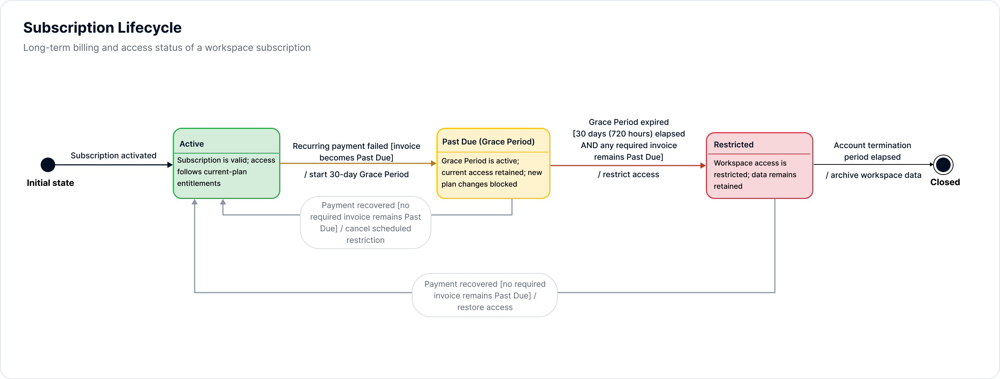
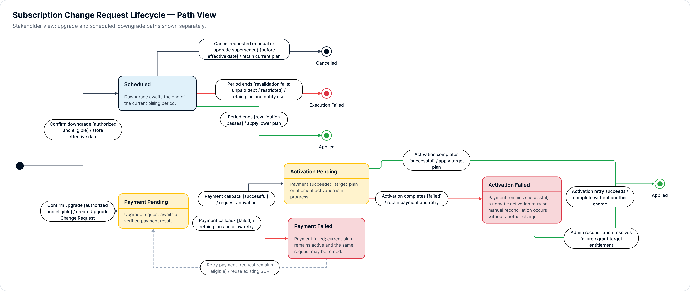

> Source: [State Transition Model Specification](https://mindyworkflows.atlassian.net/wiki/spaces/~712020023d2d45822847ceae0a13314552bb4b/pages/131234) · Content ID `131234` · Version `18` · Status `current`

## Rendered diagrams





# Purpose

**Module purpose:** Define finite state machines for two separate entities: the long-lived `Subscription`, which controls billing and workspace access, and the short-lived `Subscription Change Request (SCR)`, which controls one upgrade or downgrade transaction.

**Isolation principle:** A workspace may remain `Subscription = ACTIVE` while its SCR is `SCHEDULED`, `PAYMENT_PENDING` or another non-terminal transaction state.

## 1. Canonical Domain State Enums

```typescript
type ChangeRequestStatus =
  | 'PAYMENT_PENDING'
  | 'PAYMENT_FAILED'
  | 'ACTIVATION_PENDING'
  | 'ACTIVATION_FAILED'
  | 'SCHEDULED'
  | 'APPLIED'           // Terminal
  | 'CANCELLED'         // Terminal
  | 'EXECUTION_FAILED'; // Terminal

type SubscriptionStatus =
  | 'ACTIVE'
  | 'PAST_DUE'
  | 'RESTRICTED';

type PaymentAttemptStatus =
  | 'INITIATED'
  | 'SUCCESS'
  | 'FAILED';

type EntitlementActivationStatus =
  | 'NOT_STARTED'
  | 'PROCESSING'
  | 'SUCCEEDED'
  | 'FAILED';
```

## 2. Modeling Invariants

- Business states are persisted and must change observable system behaviour.
- A workspace has one current Subscription and no more than one non-terminal SCR.
- Plan, quota, entitlement result and payment result are attributes or guards, not Subscription states.
- A scheduled downgrade does not change the current plan before its Effective Date.
- A failed upgrade payment does not change current entitlements.
- `PAST_DUE` is a Subscription state; the fixed 30-day / 720-hour Grace Period is its recovery window.
- `PAYMENT_FAILED` and `ACTIVATION_FAILED` are recoverable non-terminal states. Their closure policy must prevent a SCR from blocking the workspace indefinitely.

## 3. Terminal-State Policy

| **State** | **Terminal?** | **Meaning** | **Allowed Follow-up** |
| --- | --- | --- | --- |
| `APPLIED` | Yes | The requested plan change completed successfully. | None; create a new SCR for a later change. |
| `CANCELLED` | Yes | The request was explicitly cancelled or closed by an approved expiry policy. | None. |
| `EXECUTION_FAILED` | Yes | Execution ended without applying the requested change. | Manual investigation; any retry requires a new or explicitly reopened request policy. |
| `PAYMENT_FAILED` | No | Payment failed and the same request remains eligible for retry. | Retry payment or apply the approved abandonment/expiry policy. |
| `ACTIVATION_FAILED` | No | Payment succeeded but entitlement activation failed. | Retry activation without another charge; escalate under the approved recovery policy. |

## 4. Subscription State Model

Source file: <https://www.figma.com/design/ZBPovUXDJwxaT3sJhn2Zu9/ApproveFlow-%E2%80%94-SaaS-Subscription-Management?node-id=5-2&t=NLj8rfer20hl6yoP-1> 

This FSM controls the workspace’s long-term billing and access status.

| **Transition ID** | **Current State** | **Triggering Event** | **Guard Condition** | **Next State** | **System Actions & Side Effects** | **Traceability** |
| --- | --- | --- | --- | --- | --- | --- |
| `ST-SUB-01` | Initial | Subscription activated | Initial setup and payment are valid | `ACTIVE` | Apply current-plan entitlements and record the billing-cycle start. | Core Setup |
| `ST-SUB-02` | `ACTIVE` | Recurring payment fails | A required invoice becomes `PAST_DUE` | `PAST_DUE` | Start the fixed 30-day / 720-hour Grace Period; show the payment warning; block new SCRs. | `BR-GRACE-01` · `BR-ELIG-01` |
| `ST-SUB-03` | `PAST_DUE` | Payment is recovered within the Grace Period | No required invoice remains `PAST_DUE` | `ACTIVE` | Stop the Grace Period timer; clear the warning; re-enable new SCRs. | `BR-GRACE-01` · `BR-REC-01` |
| `ST-SUB-04` | `PAST_DUE` | The 30-day timer expires | At least one required invoice remains `PAST_DUE` | `RESTRICTED` | Call Access Service to apply read-only access and send the restriction notification. | `BR-REC-01` |
| `ST-SUB-05` | `RESTRICTED` | Payment is recovered after restriction | No required invoice remains `PAST_DUE` | `ACTIVE` | Set business state to `ACTIVE`, then call Access Service to restore full access. | `BR-REC-01` |

## 5. Subcription Change Request State Model


Source file: <https://www.figma.com/design/ZBPovUXDJwxaT3sJhn2Zu9/ApproveFlow-%E2%80%94-SaaS-Subscription-Management?node-id=12-219&t=NLj8rfer20hl6yoP-1> 

This FSM controls one self-service upgrade or scheduled downgrade transaction. It does not replace the Subscription FSM.

| **Transition ID** | **Scope** | **Current State** | **Triggering Event** | **Guard Condition** | **Next State** | **System Actions & Side Effects** | **Traceability** |
| --- | --- | --- | --- | --- | --- | --- | --- |
| `ST-CR-01` | Downgrade | Initial | User confirms scheduled downgrade | Authorized; eligible; no conflicting non-terminal SCR | `SCHEDULED` | Store the Effective Date and schedule execution for billing-cycle end. | `BR-AUTH-01` · `BR-DOWN-01` |
| `ST-CR-02` | Downgrade | `SCHEDULED` | User cancels scheduled downgrade | Cancellation occurs before the Effective Date | `CANCELLED` | De-schedule the execution job and close the SCR. The current plan remains unchanged by invariant. | `BR-DOWN-01` |
| `ST-CR-03` | Downgrade | `SCHEDULED` | Billing cycle ends | Eligibility revalidation fails | `EXECUTION_FAILED` | Do not apply the downgrade; notify the user and alert Platform Operations. | `BR-ELIG-01` · `DT-DOWN-01`–`DT-DOWN-04` |
| `ST-CR-04` | Downgrade | `SCHEDULED` | Billing cycle ends | Eligibility revalidation passes | `APPLIED` | Apply target-plan entitlements and quota; enforce post-effective Soft Enforcement; close the request. | `BR-DOWN-01` · `BR-DOWN-02` · `BR-ENT-01` |
| `ST-CR-05` | Upgrade | Initial | User confirms upgrade | Quote is valid; user is authorized; workspace is eligible | `PAYMENT_PENDING` | Create the Upgrade SCR, start payment and await a verified callback. | `BR-PRICE-01` · `BR-AUTH-01` · `BR-ELIG-01` |
| `ST-CR-06` | Upgrade | `PAYMENT_PENDING` | Verified payment callback returns failure | Transaction reference matches the current request | `PAYMENT_FAILED` | Keep the current plan unchanged; show the failure and allow retry on the same request. | `BR-UPG-01` · `DT-UPG-03` |
| `ST-CR-07` | Upgrade | `PAYMENT_PENDING` | Verified payment callback returns success | Signature and idempotency checks pass | `ACTIVATION_PENDING` | Record successful payment and request target-plan entitlement activation. | `BR-UPG-01` · `QG-01` |
| `ST-CR-08` | Upgrade | `ACTIVATION_PENDING` | Entitlement activation succeeds | Target-plan entitlements and quota are active | `APPLIED` | Close the request and send payment and activation confirmation. | `BR-UPG-01` · `DT-UPG-01` |
| `ST-CR-09` | Upgrade | `ACTIVATION_PENDING` | Entitlement activation fails or times out | The failure belongs to the current activation attempt | `ACTIVATION_FAILED` | Retain the successful payment; retry activation without another charge; alert Platform Operations. | `BR-UPG-01` · `DT-UPG-02` · `EX-UPG-03` |
| `ST-CR-10` | Upgrade | `ACTIVATION_FAILED` | Activation retry succeeds | Target-plan entitlements and quota are active | `APPLIED` | Close the request without charging again and notify the user of delayed completion. | `BR-UPG-01` · `EX-UPG-03` |
| `ST-CR-11` | Upgrade | `PAYMENT_FAILED` | User retries payment | The existing request remains eligible | `PAYMENT_PENDING` | Create a new payment attempt on the same SCR; do not create a duplicate request. | `BR-UPG-01` · `BR-CHANGE-02` |

## 6. Open Lifecycle Decisions

**Do not implement fixed thresholds yet:** the review proposes a 2-hour payment timeout and a 5-attempt activation limit, but these values are not approved in the current Business Rules, API contracts, Acceptance Criteria or UAT baseline.

| **Decision ID** | **Unresolved Transition** | **Required Decision** | **Current Handling** |
| --- | --- | --- | --- |
| `OPEN-CR-01` | `PAYMENT_FAILED → CANCELLED` | Approve payment-session TTL, abandonment trigger and whether user/admin cancellation is allowed. | Remain in `PAYMENT_FAILED`; retry on the same SCR. |
| `OPEN-CR-02` | `ACTIVATION_FAILED → EXECUTION_FAILED/CANCELLED` | Approve retry limit, backoff, escalation owner, refund/manual-resolution outcome and final terminal state. | Retry activation without another charge and escalate to Platform Operations. |

After approval, update Business Rules, Exception Matrix, API contracts, Acceptance Criteria, UAT and the diagram before adding these transitions to the canonical FSM.

## 7. Related Artefacts

- [Business Rules & Decision Tables](https://mindyworkflows.atlassian.net/wiki/x/FYAB) — guards and business outcomes.
- [Exception Matrix](https://mindyworkflows.atlassian.net/wiki/spaces/~712020023d2d45822847ceae0a13314552bb4b/pages/5373964/Exception+Matrix+Failure+Recovery) — recovery ownership and non-happy paths.
- [API, SQL & Sequence Analysis](https://mindyworkflows.atlassian.net/wiki/spaces/~712020023d2d45822847ceae0a13314552bb4b/pages/229453/API+SQL+Sequence+Analysis) — API errors, callbacks and persistence checks.

