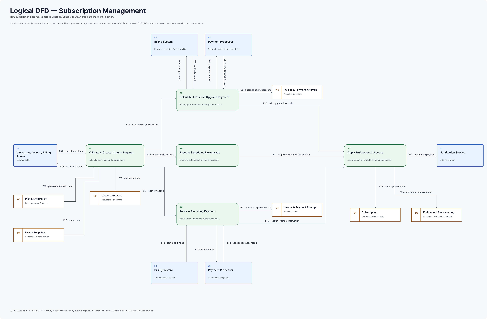
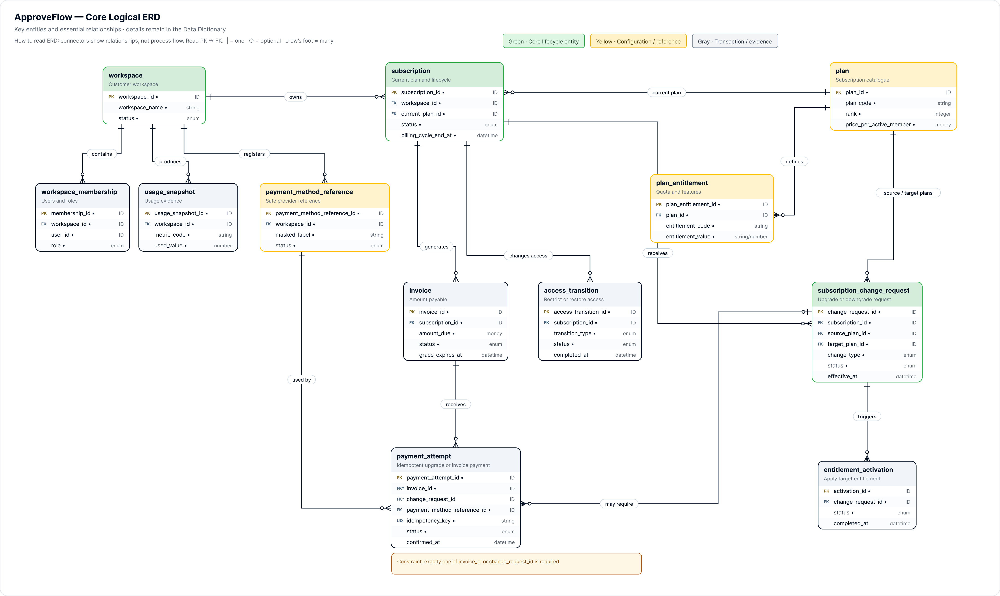

> Source: [ERD & Data Dictionary](https://mindyworkflows.atlassian.net/wiki/spaces/~712020023d2d45822847ceae0a13314552bb4b/pages/229445) · Content ID `229445` · Version `8` · Status `current`

## Packaged data models

### Logical DFD

[Open source frame in Figma](https://www.figma.com/design/ZBPovUXDJwxaT3sJhn2Zu9/ApproveFlow-%E2%80%94-SaaS-Subscription-Management?node-id=104-990)

### Core Logical ERD

[Open source frame in Figma](https://www.figma.com/design/ZBPovUXDJwxaT3sJhn2Zu9/ApproveFlow-%E2%80%94-SaaS-Subscription-Management?node-id=97-563)

# Purpose

Define how subscription data moves, which business entities ApproveFlow manages, how they relate and what their core fields mean.

`DFD → Entity Inventory → Logical ERD → Data Dictionary`

## 1. Data Flow Diagram

**Source file: **[**Logical DFD — Subscription Management**](https://www.figma.com/design/ZBPovUXDJwxaT3sJhn2Zu9/ApproveFlow-%E2%80%94-SaaS-Subscription-Management?node-id=104-990&t=NLj8rfer20hl6yoP-1)

**Read the diagram:** `E` = external actor/system · `1.0–5.0` = process · `D` = logical data store · `F` = data flow. Repeated symbols represent the same object and only improve readability.

### External entities

| **ID** | **Entity** | **Responsibility** |
| --- | --- | --- |
| E1 | Workspace Owner / Billing Admin | Initiates and reviews subscription actions |
| E2 | Billing System | Calculates price, tax/VAT, discounts, totals and invoice status |
| E3 | Payment Processor | Processes and verifies payments |
| E4 | Notification Service | Sends subscription and payment notifications |

### Core processes

| **ID** | **Process** | **Responsibility** |
| --- | --- | --- |
| 1.0 | Validate & Create Subscription Change Request (**SCR**) | Validate role, eligibility, target plan and quota |
| 2.0 | Calculate & Process Upgrade Payment | Request verified pricing and process upgrade payment |
| 3.0 | Execute Scheduled Downgrade | Revalidate and apply downgrade at the effective date |
| 4.0 | Recover Recurring Payment | Retry payment and manage recovery |
| 5.0 | Apply Entitlement & Access | Activate entitlements, restrict access or restore access |

### Logical data stores

| **Store** | **Mapped entities** | **Purpose** |
| --- | --- | --- |
| D1 — Subscription | Subscription | Current plan and lifecycle |
| D2 — SCR Store | SCR | Upgrade and downgrade requests |
| D3 — Plan & Entitlement | Plan; Plan Entitlement | Plan ranking, price, quota and features |
| D4 — Usage Snapshot | Usage Snapshot | Evidence for eligibility and quota checks |
| D5 — Invoice & Payment Attempt | Invoice; Payment Attempt; Payment Method Reference | Billing obligations and verified payment outcomes |
| D6 — Entitlement & Access Log | Entitlement Activation; Access Transition | Activation, restriction and restoration results |

## 2. Entity Inventory

| **Domain** | **Entities** | **Why the data is retained** |
| --- | --- | --- |
| Workspace & authorization | Workspace; Workspace Membership | Ownership, role and permission context |
| Plan configuration | Plan; Plan Entitlement | Plan ranking, price, quota and feature configuration |
| Subscription lifecycle | Subscription; SCR | Current subscription state and requested changes |
| Billing & usage evidence | Usage Snapshot; Invoice; Payment Method Reference; Payment Attempt | Eligibility, billing obligation and collection result |
| Execution & access | Entitlement Activation; Access Transition | Activation, restriction and restoration outcome |

## 3. Logical ERD

**Source file: **[**Open Logical ERD in Figma**](https://www.figma.com/design/ZBPovUXDJwxaT3sJhn2Zu9/ApproveFlow-%E2%80%94-SaaS-Subscription-Management?node-id=97-563&t=NLj8rfer20hl6yoP-1)

**Read the model:** start from a `PK`, follow the relationship to the matching `FK`, then read the cardinality at both endpoints.

**Plan-change invariant:** every SCR records both `source_plan_id` and `target_plan_id` so the transition remains auditable.

### Relationship map

| **Parent** | **Children / references** | **Meaning** |
| --- | --- | --- |
| Workspace | Workspace Membership; Usage Snapshot; Payment Method Reference; Subscription | A workspace owns its users, usage evidence, payment references and subscription history |
| Plan | Plan Entitlement; Subscription.current\_plan\_id; SCR.source\_plan\_id / target\_plan\_id | A plan defines entitlements and can be the current, source or target plan |
| Subscription | SCR; Invoice; Access Transition | A subscription receives change requests, invoices and access transitions |
| Invoice | Payment Attempt | An invoice can receive multiple attempts |
| SCR | Payment Attempt; Entitlement Activation | A plan change may require payment and triggers entitlement activation |
| Payment Method Reference | Payment Attempt | A safe payment-method reference can be used by multiple attempts |

### Business constraints

- Only one active Subscription is allowed per workspace.
- Only one non-terminal SCR is allowed per subscription at a time.
- A Payment Attempt may support an upgrade request or a recurring invoice.
- The Payment Processor owns complete payment credentials; ApproveFlow stores safe references only.
- Restriction or downgrade changes access, not retained customer data.

## 4. Data Dictionary

**Key:** PK = unique identifier · FK = reference to another entity · Conditional = required only for the stated business condition.

### Workspace

| **Field** | **Type** | **Required** | **Meaning** |
| --- | --- | --- | --- |
| `workspace_id` **PK** | ID | Yes | Unique workspace identifier |
| `workspace_name` | String | Yes | Workspace display name |
| `status` | Enum | Yes | Current workspace status |
| `created_at` | Datetime | Yes | Workspace creation time |

### Workspace Membership

| **Field** | **Type** | **Required** | **Meaning** |
| --- | --- | --- | --- |
| `membership_id` **PK** | ID | Yes | Unique membership |
| `workspace_id` **FK** | ID | Yes | Related workspace |
| `user_id` | ID | Yes | Related user |
| `role` | Enum | Yes | Owner, Billing Admin or Member |
| `status` | Enum | Yes | Active or inactive membership |

### Plan

| **Field** | **Type** | **Required** | **Meaning** |
| --- | --- | --- | --- |
| `plan_id` **PK** | ID | Yes | Unique plan identifier |
| `plan_code` | String | Yes | Stable code, for example BASIC |
| `plan_name` | String | Yes | Display name |
| `rank` | Integer | Yes | Classifies upgrade or downgrade |
| `price_per_active_member` | Money | Yes | Monthly member price |
| `currency` | String | Yes | Billing currency |
| `status` | Enum | Yes | Active or inactive |

### Plan Entitlement

| **Field** | **Type** | **Required** | **Meaning** |
| --- | --- | --- | --- |
| `plan_entitlement_id` **PK** | ID | Yes | Unique entitlement record |
| `plan_id` **FK** | ID | Yes | Related plan |
| `entitlement_code` | String | Yes | Feature or quota code |
| `entitlement_value` | String / Number | Yes | Allowed value or limit |
| `value_type` | Enum | Yes | Boolean, number or text |

### Subscription

| **Field** | **Type** | **Required** | **Meaning** |
| --- | --- | --- | --- |
| `subscription_id` **PK** | ID | Yes | Unique subscription |
| `workspace_id` **FK** | ID | Yes | Owning workspace |
| `current_plan_id` **FK** | ID | Yes | Current active plan |
| `status` | Enum | Yes | Active, Past Due or Restricted |
| `billing_cycle_start_at` | Datetime | Yes | Billing-cycle start |
| `billing_cycle_end_at` | Datetime | Yes | Billing-cycle end |
| `grace_expires_at` | Datetime | Conditional | Grace-period deadline |

### SCR

| **Field** | **Type** | **Required** | **Meaning** |
| --- | --- | --- | --- |
| `change_request_id` **PK** | ID | Yes | Unique change request |
| `subscription_id` **FK** | ID | Yes | Related subscription |
| `source_plan_id` **FK** | ID | Yes | Current plan |
| `target_plan_id` **FK** | ID | Yes | Requested plan |
| `change_type` | Enum | Yes | Upgrade or Downgrade |
| `status` | Enum | Yes | Payment Pending, Payment Failed, Activation Pending, Activation Failed, Scheduled, Execution Failed, Cancelled or Applied |
| `effective_at` | Datetime | Conditional | Scheduled downgrade time |
| `requested_by` | ID | Yes | Requesting user |
| `created_at` | Datetime | Yes | Creation time |
| `completed_at` | Datetime | Conditional | Terminal completion time |

### Usage Snapshot

| **Field** | **Type** | **Required** | **Meaning** |
| --- | --- | --- | --- |
| `usage_snapshot_id` **PK** | ID | Yes | Unique usage snapshot |
| `workspace_id` **FK** | ID | Yes | Related workspace |
| `metric_code` | String | Yes | Usage metric such as storage or projects |
| `used_value` | Number | Yes | Measured usage |
| `captured_at` | Datetime | Yes | Measurement time |

### Invoice

| **Field** | **Type** | **Required** | **Meaning** |
| --- | --- | --- | --- |
| `invoice_id` **PK** | ID | Yes | Unique invoice |
| `subscription_id` **FK** | ID | Yes | Related subscription |
| `amount_due` | Money | Yes | Amount payable |
| `currency` | String | Yes | Billing currency |
| `status` | Enum | Yes | Open, Paid or Past Due |
| `due_at` | Datetime | Yes | Payment deadline |
| `grace_expires_at` | Datetime | Conditional | Grace-period deadline |

### Payment Method Reference

| **Field** | **Type** | **Required** | **Meaning** |
| --- | --- | --- | --- |
| `payment_method_reference_id` **PK** | ID | Yes | Internal reference identifier |
| `workspace_id` **FK** | ID | Yes | Owning workspace |
| `provider_reference` | String | Yes | Payment-provider reference |
| `masked_label` | String | Yes | Safe display value |
| `status` | Enum | Yes | Active, expired or invalid |

ApproveFlow stores only a safe provider reference, never complete card or bank-account details.

### Payment Attempt

| **Field** | **Type** | **Required** | **Meaning** |
| --- | --- | --- | --- |
| `payment_attempt_id` **PK** | ID | Yes | Unique payment attempt |
| `idempotency_key` | String | Yes | Unique key that prevents duplicate payment processing; enforce a database unique constraint |
| `invoice_id` **FK** | ID | Conditional | Recurring invoice parent; exactly one of `invoice_id` or `change_request_id` is required, selected by transaction type |
| `change_request_id` **FK** | ID | Conditional | Upgrade SCR parent; exactly one of `invoice_id` or `change_request_id` is required, selected by transaction type |
| `payment_method_reference_id` **FK** | ID | Yes | Payment method used |
| `provider_transaction_id` | String | Conditional | Provider transaction reference |
| `status` | Enum | Yes | Pending, Successful or Failed |
| `confirmed_at` | Datetime | Conditional | Verified result time |

### Entitlement Activation

| **Field** | **Type** | **Required** | **Meaning** |
| --- | --- | --- | --- |
| `activation_id` **PK** | ID | Yes | Unique activation attempt |
| `change_request_id` **FK** | ID | Yes | Related plan change |
| `status` | Enum | Yes | Pending, Applied or Failed |
| `started_at` | Datetime | Yes | Activation start |
| `completed_at` | Datetime | Conditional | Activation completion |
| `failure_reason_code` | String | Conditional | Failure classification |

### Access Transition

| **Field** | **Type** | **Required** | **Meaning** |
| --- | --- | --- | --- |
| `access_transition_id` **PK** | ID | Yes | Unique access transition |
| `subscription_id` **FK** | ID | Yes | Related subscription |
| `transition_type` | Enum | Yes | Restrict or Restore |
| `status` | Enum | Yes | Pending, Completed or Failed |
| `reason_code` | String | Yes | Reason for the transition |
| `completed_at` | Datetime | Conditional | Successful completion time |

