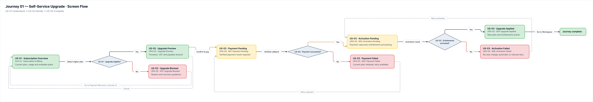
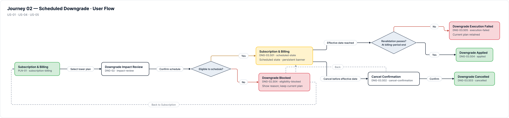
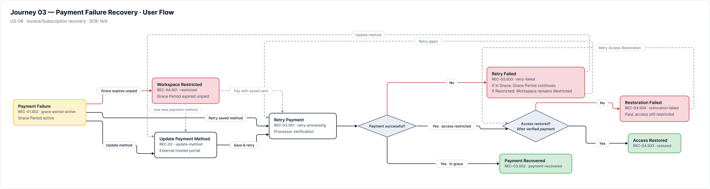

# UX Specifications

> Source: [Wireframes & UI States](https://mindyworkflows.atlassian.net/wiki/spaces/~712020023d2d45822847ceae0a13314552bb4b/pages/66150) · Content ID `66150` · Version `10` · Status `current`

## Packaged visual baseline

### Journey 1 — Self-Service Upgrade

### Journey 2 — Scheduled Downgrade

### Journey 3 — Payment Failure Recovery

---

# Purpose

Groups all UX/UI design assets by user journey. Detailed visual designs are maintained centrally in Figma.

**How to Read Each Journey**  
**1. Interaction Flow:** The navigation sequence used to complete the task.  
**2. Wireframes:** The core information and available actions on each screen.  
**3. UI States:** How the interface responds to data conditions and system events.  

**Screen & State IDs**

- Screen: `{DOMAIN}-{NN} · {Screen Name}` — domains: `PLN`, `UPG`, `DNG`, `REC`.
- State: `{SCREEN_ID}.S{NN} · {State Name}`. Always use the full state ID.
- IDs are design/spec metadata, not product UI.
- `SCR` means **Subscription Change Request**; never use it as a screen prefix.

# Journey 1 — Self-Service Upgrade

Upgrade from the current plan to a higher plan, process payment immediately, and activate the new plan entitlements.

## 1. Interaction Flow

**Source file:** [Open Journey 1 Interaction Flow in Figma](https://www.figma.com/design/ZBPovUXDJwxaT3sJhn2Zu9/ApproveFlow-%E2%80%94-SaaS-Subscription-Management?node-id=39-2&t=NLj8rfer20hl6yoP-1)

`PLN-01 Subscription & Billing` → select a higher plan → `UPG-02 Upgrade Preview` → confirm and pay → `UPG-03 Payment & Activation Outcome`.

- **Payment succeeds:** activate the target-plan entitlements immediately and redirect to the Workspace Dashboard.
- **Payment fails:** retain the current plan, show the failure reason, and allow an immediate retry.
- **Activation fails after payment:** retain the successful payment and enable automatic or manual activation retry without charging again.

## 2. Wireframes

**Source file:** [Open Journey 1 Wireframes in Figma](https://www.figma.com/design/ZBPovUXDJwxaT3sJhn2Zu9/ApproveFlow-%E2%80%94-SaaS-Subscription-Management?node-id=468-2&t=NLj8rfer20hl6yoP-1)

| **Screen** | **What the User Sees and Does** |
| --- | --- |
| `PLN-01` — Subscription & Billing | View the current plan, actual usage, available plans, and plan-change action. |
| `UPG-02` — Upgrade Preview | View the target plan, member count, prorated charge, total payable amount (TTL 15m), and payment confirmation action. |
| `UPG-03` — Payment & Activation Outcome | Track payment verification, entitlement activation, and the final execution outcome. |

## 3. UI States

**Source file:** [Open Journey 1 UI States in Figma](https://www.figma.com/design/ZBPovUXDJwxaT3sJhn2Zu9/ApproveFlow-%E2%80%94-SaaS-Subscription-Management?node-id=478-6&t=NLj8rfer20hl6yoP-1)

| **Screen** | **Possible States** |
| --- | --- |
| `PLN-01` | `PLN-01.S01 Loading` · `PLN-01.S02 Ready` · `PLN-01.S03 Blocked — Past Due` · `PLN-01.S04 Load Error` |
| `UPG-02` | `UPG-02.S01 Calculating` · `UPG-02.S02 Preview Ready` · `UPG-02.S03 Preview Expired` · `UPG-02.S04 Eligibility Blocked` · `UPG-02.S05 Calculation Error` |
| `UPG-03` | `UPG-03.S01 Payment Pending` · `UPG-03.S02 Payment Failed` · `UPG-03.S03 Activation Pending` · `UPG-03.S04 Upgrade Applied` · `UPG-03.S05 Activation Failed` |

---

# Journey 2 — Scheduled Downgrade

Review resource impact, schedule a lower plan for the end of the billing cycle, and allow cancellation before the effective date.

## 1. Interaction Flow

**Source file: **[Open Journey 2 Interaction Flow in Figma](https://www.figma.com/design/ZBPovUXDJwxaT3sJhn2Zu9/ApproveFlow-%E2%80%94-SaaS-Subscription-Management?node-id=54-2475)

`PLN-01 Subscription & Billing` → select a lower plan → `DNG-02 Downgrade Impact Review` → confirm the schedule → `DNG-03 Subscription & Billing (Scheduled State)`.

- **Schedule confirmed:** schedule the downgrade for the end of the billing cycle and show a persistent banner. Over-quota usage still allows scheduling under Soft Enforcement.
- **Cancellation before the effective date:** cancel the schedule through a confirmation modal, close the SCR, and retain the current plan.
- **Effective-date execution succeeds:** apply the lower limits, preserve all existing data, and block creation of resources above the new limits.
- **Effective-date execution fails:** retain the current plan and entitlements, and record the operational failure for support handling.

## 2. Wireframes

**Source file:** [Open Journey 2 Wireframes in Figma](https://www.figma.com/design/ZBPovUXDJwxaT3sJhn2Zu9/ApproveFlow-%E2%80%94-SaaS-Subscription-Management?node-id=468-3&t=NLj8rfer20hl6yoP-1)

| **Screen** | **What the User Sees and Does** |
| --- | --- |
| `PLN-01` — Subscription & Billing | View the current plan, resource quotas, and eligible lower plans. |
| `DNG-02` — Downgrade Impact Review | Review actual usage, over-quota warnings under Soft Enforcement, the effective date, and the scheduling action. |
| `DNG-03` — Subscription & Billing (Scheduled State) | The Subscription & Billing page with a persistent downgrade banner and a **Cancel downgrade**. |

## 3. UI States

**Source file:** [Open Journey 2 UI States in Figma](https://www.figma.com/design/ZBPovUXDJwxaT3sJhn2Zu9/ApproveFlow-%E2%80%94-SaaS-Subscription-Management?node-id=478-7&t=NLj8rfer20hl6yoP-1)

| **Screen** | **Possible States** |
| --- | --- |
| `PLN-01` | `PLN-01.S01 Loading Plans` · `PLN-01.S02 Ready` · `PLN-01.S03 Blocked — Past Due` · `PLN-01.S04 Load Error` |
| `DNG-02` | `DNG-02.S01 Calculating Impact` · `DNG-02.S02 Review Ready` · `DNG-02.S03 Over-quota Warning` · `DNG-02.S04 Eligibility Blocked` · `DNG-02.S05 Impact Calculation Error` |
| `DNG-03` | `DNG-03.S01 Scheduled (Persistent Banner)` · `DNG-03.S02 Cancel Confirmation` · `DNG-03.S03 Cancelled` · `DNG-03.S04 Applied` · `DNG-03.S05 Execution Failed` |

---

# Journey 3 — Payment Failure Recovery

Resolve an overdue recurring invoice, securely update the payment method, and restore Workspace access.

## 1. Interaction Flow

**Source file:** [Open Journey 3 Interaction Flow in Figma](https://www.figma.com/design/ZBPovUXDJwxaT3sJhn2Zu9/ApproveFlow-%E2%80%94-SaaS-Subscription-Management?node-id=54-2544&t=NLj8rfer20hl6yoP-1)

`REC-01 Grace Period Overview` → securely update the payment method in `REC-02` when needed → retry payment in `REC-03` → view the restriction or restoration outcome in `REC-04`.

- **Payment succeeds during the Grace Period:** stop the 30-day (720-hour) timer, remove the warning, and keep the Workspace Active.
- **Payment retry fails:** preserve the current access state—continue the Grace Period countdown if time remains, or keep the Workspace Restricted after expiry.
- **Payment remains overdue after 30 days (720 hours):** the Access Service moves the Workspace to Restricted (Read-only).
- **Access restoration fails after payment:** do not charge again; show the restoration failure with manual retry and support-contact actions.

## 2. Wireframes

**Source file:** [Open Journey 3 Wireframes in Figma](https://www.figma.com/design/ZBPovUXDJwxaT3sJhn2Zu9/ApproveFlow-%E2%80%94-SaaS-Subscription-Management?node-id=469-4&t=NLj8rfer20hl6yoP-1)

| **Screen** | **What the User Sees and Does** |
| --- | --- |
| `REC-01` — Grace Period Overview | View the overdue invoice, 30-day (720-hour) countdown, access state, and actions to retry payment or update the card. |
| `REC-02` — Processor-Hosted Payment Update | Use the Payment Processor-hosted card interface; ApproveFlow never handles card data. |
| `REC-03` — Payment Retry & Processing | Track the payment request sent to the bank and the returned transaction status. |
| `REC-04` — Restriction Paywall & Restoration | View the Restricted (Read-only) paywall after 30 days, payment-recovery actions, and Full Access restoration progress. |

## 3. UI States

**Source file: **[Open Journey 3 UI States in Figma](https://www.figma.com/design/ZBPovUXDJwxaT3sJhn2Zu9/ApproveFlow-%E2%80%94-SaaS-Subscription-Management?node-id=72-709&t=NLj8rfer20hl6yoP-1)

| **Screen** | **Possible States** |
| --- | --- |
| `REC-01` | `REC-01.S01 Loading Recovery Status` · `REC-01.S02 Grace Period Active` · `REC-01.S03 Load Error` |
| `REC-02` | `REC-02.S01 Hosted Update Ready` · `REC-02.S02 Processor Update In Progress` · `REC-02.S03 Processor Validation Error` · `REC-02.S04 Update Failed` · `REC-02.S05 Reference Updated` |
| `REC-03` | `REC-03.S01 Retry Processing` · `REC-03.S02 Payment Recovered` · `REC-03.S03 Retry Failed` |
| `REC-04` | `REC-04.S01 Restricted (Read-only)` · `REC-04.S02 Restoration Pending` · `REC-04.S03 Access Restored (Full Access)` · `REC-04.S04 Restoration Failed` |

