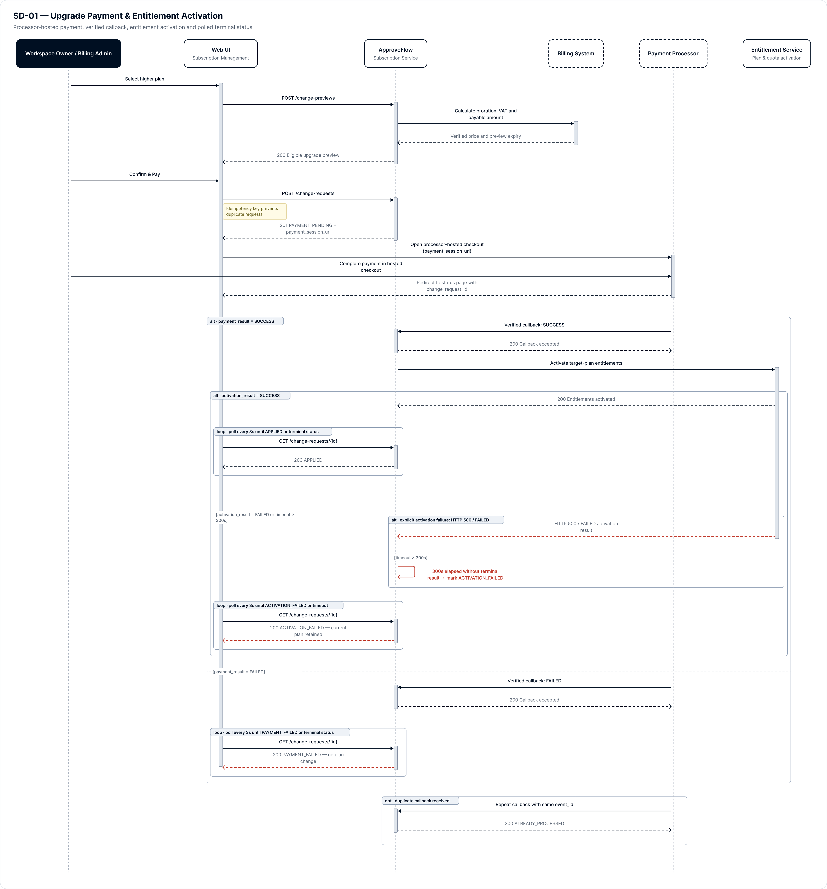
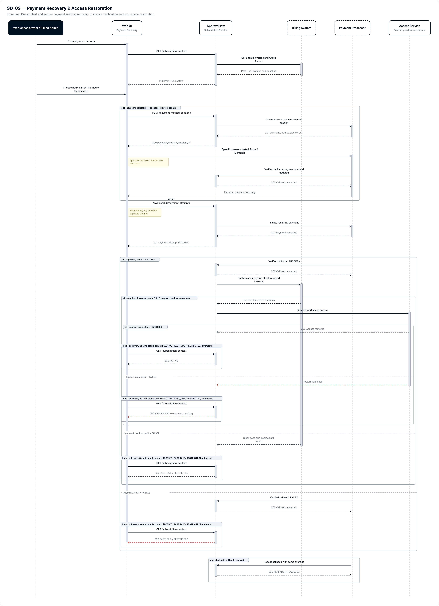
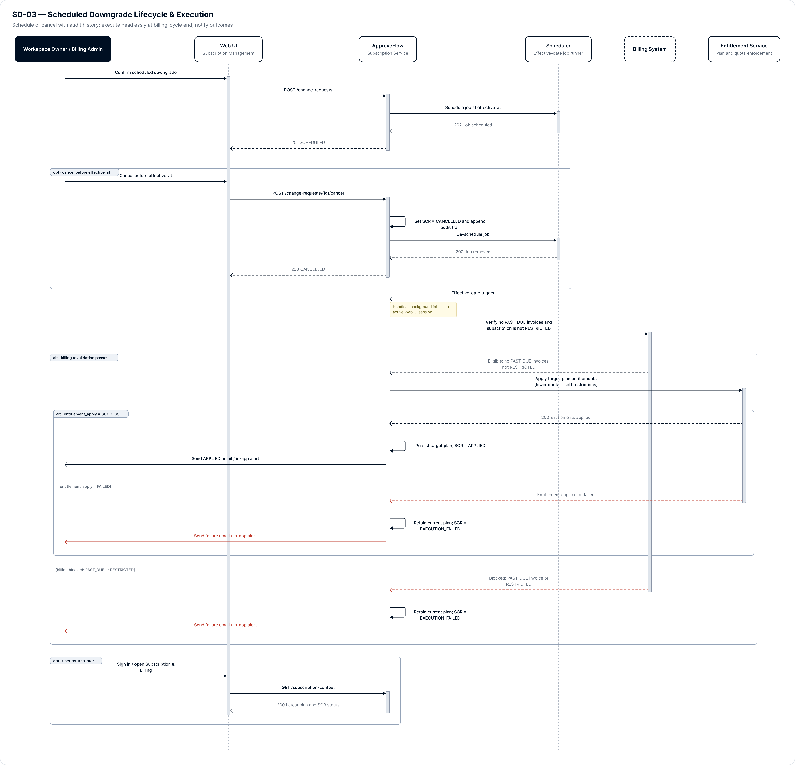

# Sequence Diagrams

> Source: [API, SQL & Sequence Analysis](https://mindyworkflows.atlassian.net/wiki/spaces/~712020023d2d45822847ceae0a13314552bb4b/pages/229453) · Content ID `229453`

## Packaged sequence diagrams

### SD-01 — Upgrade Payment & Entitlement Activation

[Open source frame in Figma](https://www.figma.com/design/ZBPovUXDJwxaT3sJhn2Zu9/ApproveFlow-%E2%80%94-SaaS-Subscription-Management?node-id=123-2029)

### SD-02 — Payment Recovery & Access Restoration

[Open source frame in Figma](https://www.figma.com/design/ZBPovUXDJwxaT3sJhn2Zu9/ApproveFlow-%E2%80%94-SaaS-Subscription-Management?node-id=123-2132)

### SD-03 — Scheduled Downgrade Lifecycle & Execution

[Open source frame in Figma](https://www.figma.com/design/ZBPovUXDJwxaT3sJhn2Zu9/ApproveFlow-%E2%80%94-SaaS-Subscription-Management?node-id=385-2201)

DESIGNED — NOT EXECUTED Business-level contracts for analysis and testing. No endpoint call, database query, integration test or production validation has been executed.
# 3. Sequence Scenarios

## **SD-01 — Upgrade Payment & Entitlement Activation**

`API-02 → API-03 → API-05`. Covers payment success/failure and entitlement activation success/failure. Upgrade is complete only after entitlement activation succeeds.

**Source file**: [Sequence · SD-01 — Upgrade Payment & Entitlement Activation](https://www.figma.com/design/ZBPovUXDJwxaT3sJhn2Zu9/ApproveFlow-%E2%80%94-SaaS-Subscription-Management?node-id=123-2029&t=NLj8rfer20hl6yoP-1) 

## S**D-02 — Payment Failure Recovery & Access Restoration**

`API-04 → API-05`. Covers retry success/failure, unpaid invoice, restoration success and restoration failure. Access is restored only after all required invoices are paid.

**Source file: **[Sequence · SD-02 — Payment Recovery & Access Restoration](https://www.figma.com/design/ZBPovUXDJwxaT3sJhn2Zu9/ApproveFlow-%E2%80%94-SaaS-Subscription-Management?node-id=123-2132&t=NLj8rfer20hl6yoP-1) 

## SD-03 **—** **Scheduled Downgrade Lifecycle & Execution**

`API-03`. Covers schedule creation, cancellation before `effective_at`, execution-time revalidation, apply success and execution failure.

**Source file:** [Sequence · SD-03 — Scheduled Downgrade Lifecycle & Execution](https://www.figma.com/design/ZBPovUXDJwxaT3sJhn2Zu9/ApproveFlow-%E2%80%94-SaaS-Subscription-Management?node-id=385-2201&t=NLj8rfer20hl6yoP-1)

